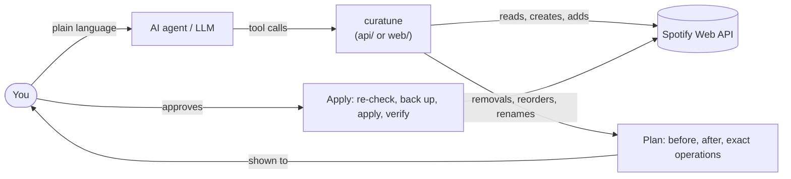

# curatune - playlist curation for Spotify, by asking an AI agent

curatune lets you curate your own Spotify playlists in plain language: build a playlist from a criterion,
find duplicates, put it in recording order, clean it up. Anything that removes, reorders, or renames tracks
is shown to you as a plan first, and only applied after you approve it.

Demo of the web app:

https://github.com/user-attachments/assets/fea158f1-b15d-47c1-aaed-993415a28dab

If the video doesn't play, [download the MP4](docs/assets/curatune_demo.mp4).

> curatune is an independent project. It is not affiliated with, endorsed by, or sponsored by Spotify.
> Spotify is a trademark of Spotify AB.

## What's inside

| Folder | What it is | Built with |
|---|---|---|
| [`api/`](api/) | The core: a Python library, a JSON CLI for coding agents (Claude Code, Codex, Gemini CLI, and others), and a local **MCP server** for MCP clients | Python 3.10+, `requests`, the `mcp` SDK |
| [`web/`](web/) | A chat app in the browser: the agent runs in the page and talks to a **local LLM** (LM Studio or Ollama) | TypeScript, Vite, no UI framework |

Both follow the same rules (the web app is a port of `api/`, kept in step with it), and both work with
your own Spotify account through your own Spotify app.

Some things to ask: *"Create a playlist with the landmark recordings of early bebop"*, *"Are there
duplicates in X?"*, *"Sort X by recording date"*, *"Add 10 tracks that fit X"*, *"Rename X to Y"*.

## Try it without a Spotify account

`curatune-mcp --demo` serves a synthetic account in memory: a few playlists (one with duplicates and a
shuffled order, another whose description tries to give the assistant orders) and a small catalog. No
Spotify account, no `.env`, no token, no network; everything disappears when the server stops.

Clone the repository; the commands start at its root. They are written for PowerShell or Git Bash on
Windows (not `cmd`), with the macOS/Linux variants in comments.

```bash
cd api
python -m venv .venv                                # python3 on macOS/Linux
.venv/Scripts/python -m pip install -e ".[mcp]"     # .venv/bin/python on macOS/Linux
```

Then add it to an MCP client. With [Claude Code](https://claude.com/claude-code), from a folder outside the
repository (`<repo>` is the absolute path of your clone):

```bash
claude mcp add curatune-demo -- <repo>/api/.venv/Scripts/curatune-mcp.exe --demo   # <repo>/api/.venv/bin/curatune-mcp on macOS/Linux
claude
```

and ask, for example: *"Which playlists do I have?"*, *"Find the duplicates in Bebop test and remove
them"*. Other MCP clients use the same command with `--demo` as its argument
([docs](api/docs/mcp.md#demo-mode)); demo mode is verified in Claude Code and Claude Desktop. The web app
has no demo mode yet.

## Run it with your Spotify account

### 1. Requirements

- A Spotify account with **Premium**: Spotify requires it of the owner of an app in Development Mode.
- Python 3.10 or newer (for `api/`) and Node.js 22 or newer (for `web/`).
- An AI client: any coding agent or MCP client for `api/`; for `web/`, [LM Studio](https://lmstudio.ai) or
  [Ollama](https://ollama.com) (or a hosted OpenAI-compatible API, such as Gemini).

### 2. Create your Spotify app

1. Go to the [Spotify Developer Dashboard](https://developer.spotify.com/dashboard), create an app, and
   select **Web API**.
2. Add these **redirect URIs**, exactly as written (`127.0.0.1`, not `localhost`):
   - `http://127.0.0.1:8888/callback` for the CLI and the MCP server;
   - `http://127.0.0.1:5173/callback` for the web app.
3. Copy the app's **Client ID**. There is no client secret to copy: both sides use OAuth with PKCE.

The app stays in Development Mode: you can use it, and you can let up to 5 people use it by adding them
under *User Management*.

### 3. The CLI and the MCP server (`api/`)

```bash
cd api                                              # from the repository root
cp .env.example .env                                # then set SPOTIFY_CLIENT_ID in .env
python -m venv .venv                                # skip if you made it for the demo; python3 on macOS/Linux
.venv/Scripts/python -m pip install -e ".[mcp]"     # .venv/bin/python on macOS/Linux
.venv/Scripts/curatune auth login                   # opens Spotify's consent page; .venv/bin/curatune on macOS/Linux
.venv/Scripts/curatune playlists list               # your playlists, as JSON
```

Then either open a coding agent **in `api/`** (it learns the commands and the safety rules from the
project's skill; see [api/README.md](api/README.md#using-it-with-an-ai-agent)), or add the MCP server to
your MCP client, for example:

```bash
claude mcp add curatune -- <repo>/api/.venv/Scripts/curatune-mcp.exe   # <repo>/api/.venv/bin/curatune-mcp on macOS/Linux
```

Claude Desktop, LM Studio, and the other settings are in [api/docs/mcp.md](api/docs/mcp.md). To install
`api/` without a clone, with pipx or uvx from GitHub, see
[api/README.md](api/README.md#without-cloning-the-repository).

### 4. The web app (`web/`)

1. Start your LLM server and load a model with a context length of **at least 32768 tokens**.
   - LM Studio: start the server (Developer tab) and enable **CORS**; if it runs on another computer,
     enable *Serve on Local Network* too.
   - Ollama: let the app's origin in, with the environment variable
     `OLLAMA_ORIGINS=http://127.0.0.1:5173`.
2. Configure and start the app:

   ```bash
   cd web                       # from the repository root
   cp .env.example .env.local   # set VITE_SPOTIFY_CLIENT_ID, VITE_LLM_BASE_URL, VITE_LLM_MODEL
   npm ci
   npm run dev                  # then open http://127.0.0.1:5173 (127.0.0.1, not localhost)
   ```

   `VITE_LLM_BASE_URL` is the server's OpenAI-compatible address, including `/v1`: for example
   `http://127.0.0.1:1234/v1` (LM Studio) or `http://127.0.0.1:11434/v1` (Ollama). `npm run dev` reads
   `.env.local` when it starts: restart it after changing the file, then reload the page.
3. Log in with Spotify, pick a playlist on the left, and chat.

## How it works



- **Plan, then confirm.** Creating a playlist and filling it in the same session run directly; adding tracks to
  a playlist you already had waits for your OK (a Confirm button in the web app, the dialog or page through
  MCP). Removals, reorders, renames,
  and description changes are only ever built as *plans*: the state before, the state after, and the exact
  operations. A plan is applied only after you approve it, and the model can't approve for you:
  - in the web app, only the **Apply** button applies a plan; the model has no tool for it;
  - through MCP, your client shows a confirmation dialog; clients without one open a local page that
    shows the plan and, if you approve, a one-time code you paste in the chat.
- **Backups and checks.** Applying a plan first checks that the playlist hasn't changed since the plan was
  made, saves a backup of it, then verifies the result. Sorting (by title, artist, album, release date,
  duration, or recording date) is computed in code, not guessed by the model.
- **OAuth with PKCE, no client secret.** The CLI receives the login on a local server
  (`127.0.0.1:8888`) and keeps the token outside the repository. The web app keeps it in the browser tab
  and sends it only to Spotify; there is no backend, and a strict Content Security Policy limits what the
  page can talk to.
- **The MCP server** is local (stdio). Its tools call the same library functions as the CLI, show the
  model 1-based track numbers, and carry the safety rules in their descriptions.
- **The web agent** is a small tool-calling loop in TypeScript, running in the page against any
  OpenAI-compatible endpoint: a local model by default, or a hosted one you choose per chat. The model
  sees only the conversation and trimmed results ([what they contain](#spotifys-terms-and-this-project)),
  never the token.
- **Text written by other people is data.** Playlist names and descriptions are treated as untrusted; a
  playlist that tells the assistant to delete everything changes nothing (tested).
- **Spotify's API quirks, worked around:** reads that lag behind writes, playlists that can't be made
  private, descriptions that can't be cleared, list counts that lag. See
  [api/docs/reference.md](api/docs/reference.md).

## Spotify's terms and this project

- **Your own Spotify app, in Development Mode.** Spotify's Development Mode requires Premium for the app
  owner and allows 5 users per app; Extended Quota is granted only to organizations (a registered
  business with a launched service and at least 250,000 monthly active users). So curatune has no hosted
  instance: everyone runs it with their own app.
- **AI models.** Spotify's Developer Terms (IV.2.1) and Developer Policy (III.14) say not to "ingest
  Spotify Content into a machine learning or AI model". curatune sends playlist and track metadata to the
  model you choose, so that it can work with your playlists. Read those terms and decide for yourself:
  **you are responsible for using your Spotify app within them.**
  - *What the model receives:* the conversation, including the results of the tools it calls: track
    metadata (names, artists, album, and similar) and, when it reads a playlist, its details and tracks.
    Playlist names and descriptions can be text written by other people. The model's first ideas for a
    playlist can come from its own knowledge, before it searches Spotify.
  - *Where it goes:* in the web app, to the endpoint set in `VITE_LLM_BASE_URL`, wherever that runs, or,
    when you select a hosted model, to its provider; a notice in the app says so, citing those terms (you
    can dismiss it). With MCP, your MCP client chooses the model and provider: curatune's server runs
    locally over stdio, the model may not.
  - *The Spotify token:* the web app's requests to the model don't include it (the only credential they
    carry is a hosted provider's own API key), and the MCP `auth_login` result doesn't include it. That is what the code and
    its tests check, not a wider guarantee.
- **No indefinite storage.** Plans and backups keep copies of track metadata, so they are deleted after 90
  days (`CURATUNE_RETENTION_DAYS` in `api/`). Stored recording dates keep only your data (date, source,
  confidence) and track IDs, never names. Tokens stay on your machine.
- **Attribution.** Where Spotify content is shown (the web app, the MCP confirmation page), the official
  Spotify logo and links back to Spotify are shown too, as Spotify's design guidelines require. Those logos
  (in `web/public/brand/` and `api/src/curatune/mcp_server/assets/`) are trademarks of Spotify AB and are
  not covered by this project's license.
- **Non-commercial.** curatune is a personal, non-commercial project, published as source code.

## Known limitations

- Spotify makes every playlist created through its API **public**, whatever is requested, and its API
  can't change visibility: make playlists private in the Spotify app.
- Only playlists you own or collaborate on can be read track by track or changed.
- Spotify gives the release date of an edition, not the recording date. Recording dates come from the
  model's knowledge or from sources it can check, and a model can be confidently wrong: small local models
  often are ([evaluation](web/docs/evaluation.md)). Dates are stored with their source and confidence so
  you can check them.
- In our evaluation, a local 9B model took about 20-30 seconds per step; hosted models are much faster and
  better informed, but they receive your playlist metadata.
- The web app is a single-user prototype: no demo mode, no remote access.
- MCP clients: verified with Claude Code, and with Claude Desktop in demo mode (stdio, synthetic
  playlists; checked on 2026-11-05). Not verified yet with LM Studio.

## Next steps

- A demo mode for the web app, on its in-memory Spotify used by the tests.
- Publishing the Python package on PyPI, so `api/` installs without a Git URL.
- Verifying the MCP server with more clients, such as LM Studio.
- Remote access to the web app (an outbound tunnel, authentication, and a proxy that only allows chat
  completions), still without exposing the LLM server.

## Documentation

| | |
|---|---|
| [api/README.md](api/README.md) | The CLI: what you can do, safety, commands, configuration |
| [api/docs/reference.md](api/docs/reference.md) | CLI contract, JSON shapes, error and warning codes, the plan format, Spotify API notes |
| [api/docs/mcp.md](api/docs/mcp.md) | The MCP server: setup, tools, confirmation flow, demo mode |
| [api/docs/design.md](api/docs/design.md) | The MCP server's design: decisions, the confirmation model, threats |
| [web/README.md](web/README.md) | The web app: setup and development |
| [web/docs/evaluation.md](web/docs/evaluation.md) | How models were evaluated for the web app, and the results |

## Development

```bash
# api/ (from the repository root)
cd api
.venv/Scripts/python -m pip install -e ".[dev,mcp]"   # .venv/bin/python on macOS/Linux
.venv/Scripts/python -m pytest
.venv/Scripts/python -m ruff check src tests

# web/
cd ../web
npm ci
npm test
npm run build      # typecheck and production build
npm run eval       # evaluate models against the in-memory Spotify (see web/README.md)
```

CI ([.github/workflows/tests.yml](.github/workflows/tests.yml)) runs on pushes to `main` and on pull
requests: `api/` on Windows and Linux, with Python 3.10 and 3.14, with and without the `mcp` extra; `web/`
on Node 22. Development instructions for coding agents are in [`api/AGENTS.md`](api/AGENTS.md) and
[`web/AGENTS.md`](web/AGENTS.md).

## Security

To report a vulnerability, see [SECURITY.md](SECURITY.md).

## License

MIT License, Copyright (c) 2026 Gabriel de Giuli. See [LICENSE](LICENSE). The Spotify logos in this
repository are trademarks of Spotify AB and are not covered by it ([NOTICE](NOTICE)).
