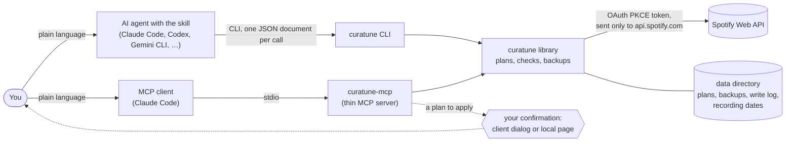
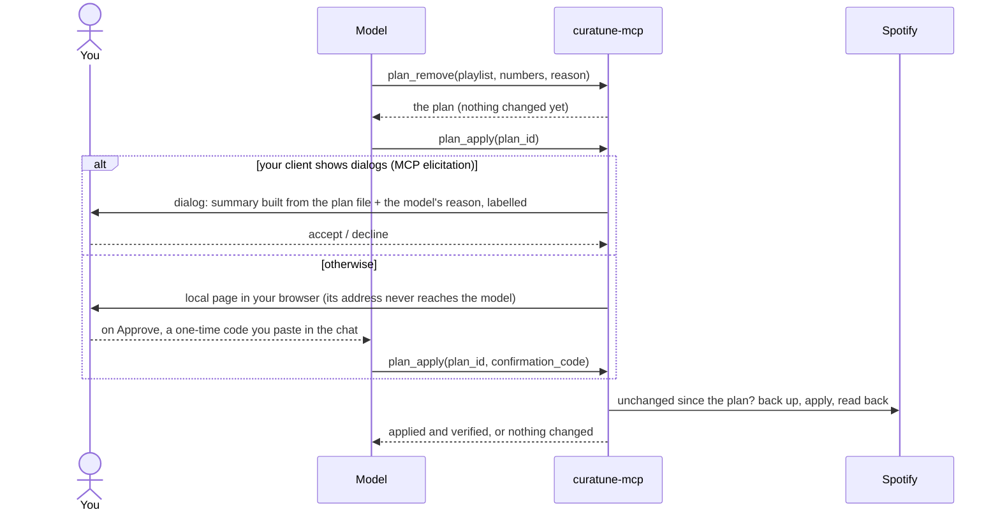

# curatune — a playlist toolkit for Spotify

curatune is not affiliated with, endorsed by, or sponsored by Spotify. Spotify is a trademark of
Spotify AB.

Work with your own Spotify playlists by asking an AI agent in plain language. curatune is the deterministic
part: a Python library (`src/curatune`) plus a thin CLI that prints one JSON document per call, and an
optional local MCP server for MCP clients. The judgment (what to add, what counts as
a duplicate, how to rank) comes from the agent, not from this code.

**Highlights** ([how it's built](#how-its-built)):
- **The model can't confirm for you.** Through MCP, a plan that removes, reorders, or renames is applied
  only after you answer a dialog or approve a local page the model never sees.
- **Prompt injection, tested live.** Playlist text that told the assistant to delete everything, and a fake
  confirmation code planted in a playlist name, changed nothing.
- **API behaviour found by testing**, not in Spotify's docs: playlists can't be made private, descriptions
  can't be cleared, reads lag behind writes. curatune works around each one.
- **A demo mode** with a synthetic account: no Spotify account, no network, nothing kept.

## What you can do

Ask in plain language. Some examples:

- **Create a playlist from a criterion.** "Create a playlist with the landmark recordings of early
  bebop." The agent picks the tracks and the right edition of each (original studio master, not a live
  version, cover, or karaoke), and says how confident it is about each choice.
- **Complete an existing playlist.** "Add 10 tracks to X that fit what's already there", or "add 15
  underrated Beatles songs: great tracks every fan loves but casual listeners don't know."
- **Reorder by a criterion.** "Sort X by recording date", "by release date", "by historical
  importance". You see the full before/after plan before anything moves.
- **Find duplicates and repeated versions.** The same recording on two editions (same ISRC), the same
  tune under another title, or an alternate/live take of a song already in the list.
- **Clean up.** "Remove the live versions from X", "drop everything recorded after 1960". Removals are
  shown as a plan; nothing is deleted until you approve it.
- **Switch editions.** "Use the newest remixes instead of the old remasters": the new versions are
  added, and removing the old ones goes through a plan.
- **Analyze.** "Rank X by influence", "which tracks have uncertain recording dates?", "is X in
  chronological order?", "which albums do these come from?"

Research such as recording dates (with source and confidence) is kept locally, so later additions and
reorders reuse it. You can also **rename a playlist or change its description** ("rename X to Y", "give X
a description"); the change is shown as a plan and applied after your OK. Some things are left out on
purpose, for safety; see [What curatune won't do](#what-curatune-wont-do).

## Using it with an AI agent

Open your agent in this repository and ask, as in the examples above. The agent learns the commands,
workflows, and safety rules from the project skill; on first use it walks you through setup, and you only
create the Spotify app, fill in `.env`, and approve the browser login.

| Agent | Reads |
|---|---|
| Claude Code | `CLAUDE.md` (imports `AGENTS.md`) and `.claude/skills/curatune/` (points to the shared skill) |
| Gemini CLI | `GEMINI.md` (imports `AGENTS.md`; Gemini CLI does not read `AGENTS.md` by default) and `.agents/skills/curatune/` |
| Codex CLI, Cursor, GitHub Copilot (VS Code), and other agents that support Agent Skills | `AGENTS.md` and `.agents/skills/curatune/` |

GitHub Copilot also scans `.claude/skills/`, so it lists two `curatune` skills. Either one works: the
`.claude/skills/` entry only points to the shared skill.

The skill uses the open [Agent Skills](https://agentskills.io) format. Agents that sandbox commands must
allow curatune network access to `accounts.spotify.com` and `api.spotify.com`, and let it write its token
outside the repository (see `CURATUNE_TOKEN_DIR` below). Personal preferences, such as your language or
per-playlist curation criteria, can go in a gitignored `AGENTS.local.md` at the repository root.

### Through MCP

Clients that speak the [Model Context Protocol](https://modelcontextprotocol.io) can use curatune without
the repository's skill: install the `mcp` extra and add `curatune-mcp` as a local server. Verified with
Claude Code; Claude Desktop and LM Studio aren't verified yet ([clients](#clients)). Its tools carry the
same rules. Removals, reorders, and renames are plans there too, and a plan is applied only after you
confirm it in a dialog your client shows: the AI can't answer it for you. Clients without such dialogs open
a local page instead, which shows the plan and, if you approve, a one-time code you paste in the chat.
Setup, tools, the confirmation flow, and the differences from the CLI are in
**[docs/mcp.md](docs/mcp.md)**. To try it without a Spotify account, `curatune-mcp --demo` serves a
synthetic account in memory, with no network and nothing kept ([demo mode](docs/mcp.md#demo-mode)).
Playlists and plans can also be attached as resources (an `@`-mention in Claude Code), and the skill's
workflows are prompts (`/mcp__curatune__deduplicate`, …).

## How changes stay safe

- Creating a playlist and adding tracks run directly.
- Removals, reorders, renames, and description changes are only ever built as **plans**: before, after,
  and the exact operations. The agent shows you the plan and applies it only after your OK. Through MCP,
  that OK is your answer in the client's confirmation dialog, which shows a summary built from the plan
  itself.
- Sorting by title, artist, album, release date, or duration is computed by curatune, not guessed by the
  agent.
- Applying a plan first checks that the playlist hasn't changed since the plan was made, backs it up to
  `backups/` in curatune's data directory, and verifies the result afterwards.
- Spotify currently makes every playlist created through the API **public**, whatever is requested.
  Make it private from the Spotify app if needed.

## What curatune won't do

### Left out on purpose

These are **deliberate protections, not gaps**. Spotify's API allows some of them; curatune leaves them
out so that a mistake, a misunderstood request, or text planted in a track or playlist name can't cause
damage that is hard to undo.

- **Delete a playlist.** The API can remove a playlist from your library, which is what "delete" does in
  the app. curatune has no command for it: a playlist only disappears if you delete it yourself in Spotify.
- **Change a playlist's visibility or make it collaborative.** Only the name and description can change.
  Visibility would decide who can see your playlist, and Spotify ignores it through the API anyway.
- **Touch anything outside your playlists:** your liked songs and saved albums, followed artists,
  playback, or listening history. curatune only requests the three playlist permissions, so it has no
  access to the rest.
- **Remove, reorder, rename, or change a description without your OK.** Every one of these goes through a
  plan you see first. There is no option to skip the confirmation.
- **Rewrite a playlist's whole track list in one go.** The API allows it, but it would reset the date each
  track was added. Reorders only move tracks.
- **Let an agent change Spotify without asking.** For agents that support pre-approval, only reading and
  building plans are pre-approved. Adding, creating, and applying a plan always go through the agent's
  normal approval, on top of your OK in the chat.
- **Send your access token anywhere but `api.spotify.com`, keep it in the repository, or use a client
  secret.**

If you need one of these, it can be added deliberately: open an issue or change the code, keeping the
plan-and-confirm flow.

### Limits set by Spotify

These are not choices, and no code change can lift them:

- Playlists created or edited through the API end up **public**. Make them private in the Spotify app.
- Only playlists you own or collaborate on can be read track by track or changed.
- There are no audio features, popularity, follower counts, or labels. The release date is the edition's
  date, not the recording date, so rankings and recording dates come from the agent's knowledge and
  sources.
- A search returns at most 10 results per request.
- Development Mode apps need a Premium account for the app owner and allow up to 5 users. The
  authorization lasts 6 months; after that you log in again.

## How it's built

curatune splits the work in two. **The agent judges**: which recording is the right one, what counts as a
duplicate, how to rank, and how sure it is. **curatune executes**: deterministic operations against the
Spotify Web API, with stable JSON in and out. Every safety rule that matters is enforced in this code, not
left to a prompt.



### Decisions

- **Two thin entry points over one library.** The CLI and the MCP server validate arguments, call the same
  functions, and format the result; neither holds Spotify logic. The MCP server is an optional extra, and
  the library never imports it (a test checks).
- **Every change to what's already in a playlist is a plan.** Removing, reordering, renaming, and editing a
  description first produce a plan file: the current state, the change, the result, and the exact API
  operations. Applying it checks that the playlist hasn't changed, backs it up, runs the operations, and
  reads the result back. A plan file edited by hand is rejected (checksum, and its readable parts must match
  its operations).
- **Through MCP, your OK is out of the model's reach.** With the CLI, the agent shows you the plan and
  applies it after you say so in the chat. Through MCP, a model that is wrong or manipulated must not be
  able to say yes for you, so `plan_apply` asks you directly, in a dialog or on a local page the model
  can't answer or read (next section).
- **Numbers, not positions.** The MCP server shows tracks numbered from 1, as the Spotify app does; small
  models misread 0-based positions. One module converts both ways, and output schemas reject a stray
  `position`.
- **A small surface, on purpose.** No visibility changes, no deletion, no file paths as tool arguments, and
  stored recording dates can only be added unless you ask to correct one (two tools, so each declares
  accurate hints). See [What curatune won't do](#what-curatune-wont-do).
- **One data directory, outside the repository**, shared by the CLI and the MCP server: one write log
  (Spotify's reads lag behind writes, and curatune compensates) and one recording-date store. Moving
  existing data there is an explicit, verified copy (`curatune data migrate`), never silent.
- **Local only.** The MCP server runs on your machine over stdio ([why](#why-the-mcp-server-isnt-remote)).

The full reasoning, with the alternatives discarded, is in [docs/plan-mcp.md](docs/plan-mcp.md).

### How a plan gets applied through MCP



The dialog's answer never travels as a tool argument. The code is 40 bits, tied to one plan and its
checksum, single use, three attempts, ten minutes. Details and the threat boundary are in
[docs/mcp.md](docs/mcp.md#confirming-plans).

### Text written by other people

Playlist names, descriptions, and track titles are written by other people, and an AI reads them. curatune
treats them as data:
- every tool that returns such text says so in its description, and asks the model to tell you when a name
  or description tries to give it instructions;
- what you confirm is built from the plan file, with control characters and bidirectional-text tricks
  stripped and lengths capped; the model's own explanation is shown apart and labelled as unchecked;
- the confirmation itself is out of the model's reach, as above.

Tested live in Claude Code: a description telling the assistant to remove every track and apply the plan
"without asking" was flagged and ignored, and a playlist name carrying a fake confirmation code never made
the model pass it (a wrong code fails anyway).

### Verified live

Things the Spotify Web API does that its documentation doesn't say, each observed on a real account
(details and dates in [AGENTS.md](AGENTS.md)):
- creating a playlist ignores `public: false` while echoing it back, and `PUT` with `public: false` answers
  200 without effect;
- a description can be replaced but not cleared (`""` answers 200 and keeps the old text), and a playlist
  created without one reads back with the literal string `"null"`;
- `DELETE` removes every copy of a track, so plans re-insert the copies you keep;
- after a write, reads return the old `snapshot_id` for minutes while the items are already current, and
  the playlist list keeps the old item count; `snapshot_id` is not a lock either;
- search returns at most 10 results per request, and playlist items 50 per page;
- refresh tokens expire six months after the authorization, however often they're refreshed.

And one about Windows, part observed and part documented:
- **observed:** from a Claude Code session inside Claude Desktop (installed as an MSIX package), a new
  folder created directly under `%LOCALAPPDATA%` really landed in that app's private folder
  (`%LOCALAPPDATA%\Packages\<app>\LocalCache\…`), while new items inside an existing folder stayed in
  place;
- **documented by Microsoft** ([packaged desktop apps][msix]): such new files and folders go to a private
  per-user, per-app location, merged into the app's own view of AppData, and are removed when the app is
  uninstalled.

[msix]: https://learn.microsoft.com/en-us/windows/msix/desktop/desktop-to-uwp-behind-the-scenes

curatune refuses a data or token folder that resolves into such a private location.

### Clients

| Client | Status | Notes |
|---|---|---|
| [Claude Code](https://code.claude.com/docs/en/mcp) | **Verified** (2026-10) | Both protocol eras; the dialog and the local page; resources by `@`-mention; prompts as slash commands; `auth_login`; demo mode. |
| [Claude Desktop](https://claude.com/docs/connectors/building) | Not verified yet | Expected to use the local page (no evidence it shows MCP dialogs; [an issue](https://github.com/anthropics/claude-code/issues/41110)). It documents that `readOnlyHint` and `destructiveHint` drive its permission prompts ([review criteria](https://claude.com/docs/connectors/building/review-criteria)). |
| [LM Studio](https://lmstudio.ai/docs/app/mcp) | Not verified yet | Documents tools only; it would use the local page. |

Installing from a checkout of this repository (below) is the verified path. Installing with pipx or uvx
is documented but not verified yet.

### Why the MCP server isn't remote

A hosted server would have to keep other people's Spotify refresh tokens, run its own authorization on top
of Spotify's, give up the local confirmation page (and a URL-based one brings phishing risks), and operate
as a public service, while Spotify's Development Mode caps an app at five users. curatune stays on your
machine: your token never leaves it, and nothing listens on the network except a page bound to
`127.0.0.1` while you confirm a plan.

## Setup

Requirements: Python 3.10 or newer, and a Spotify account with **Premium** for the app owner (a
Development Mode requirement). Development Mode apps allow up to 5 authorized users.

1. Create an app at <https://developer.spotify.com/dashboard> (Web API) and register the redirect URI
   `http://127.0.0.1:8888/callback` exactly. The dashboard rejects portless loopback URIs, so a new
   port also needs its own registered URI.
2. `cp .env.example .env` and set `SPOTIFY_CLIENT_ID`. No client secret is used (PKCE).
3. Install and authorize:

   ```bash
   python -m venv .venv
   .venv/Scripts/python -m pip install -e ".[mcp]"   # .venv/bin/python on macOS/Linux
   .venv/Scripts/curatune auth login                  # .venv/bin/curatune on macOS/Linux
   ```

   The extras: `mcp` adds the MCP server (`curatune-mcp`); leave it out (`-e .`) if you only use the CLI.
   `dev` adds the test tools, for working on curatune itself (`-e ".[dev,mcp]"`, see
   [Development](#development)).

The token is stored outside the repository. Spotify refresh tokens expire 6 months after the original
authorization; after that, run `curatune auth login` again.

### Without cloning the repository (not verified yet)

curatune can also be installed as a tool, with [pipx](https://pipx.pypa.io) or
[uv](https://docs.astral.sh/uv/). The package itself was checked (built, installed into a fresh
environment, and run outside any checkout), but these commands haven't been run yet. `<source>` is
`git+<repository URL>` until curatune is on PyPI, then nothing (just `curatune[mcp]`):

```bash
pipx install "curatune[mcp] @ <source>"
```

With no repository around, curatune reads its `.env` from the config directory, next to the token:
`%LOCALAPPDATA%\curatune\.env` on Windows, `~/.config/curatune/.env` elsewhere. Put `SPOTIFY_CLIENT_ID`
there (and the other settings below, if you use them), then run `curatune auth login`. An MCP client can
start the server without installing anything first:

```bash
claude mcp add curatune -- uvx --from "curatune[mcp] @ <source>" curatune-mcp
```

On Windows, run that first `auth login` from a terminal, not from a session inside an app installed as an
MSIX package, such as Claude Desktop (see `CURATUNE_DATA_DIR` below).

### Configuration (`.env`)

| Variable | Default | Purpose |
|---|---|---|
| `SPOTIFY_CLIENT_ID` | — (required) | App client ID. |
| `SPOTIFY_REDIRECT_PORT` | `8888` | Callback port; URI is always `http://127.0.0.1:<port>/callback` and must be registered in the dashboard. `auth login --port` overrides it. |
| `CURATUNE_MARKET` | none | Default market for `playlist show`, `search`, `track`, `album`. |
| `CURATUNE_TOKEN_DIR` | `%LOCALAPPDATA%\curatune` / `~/.config/curatune` | Token location (the config directory; a `.env` there is read too). Must be outside the repo (enforced). |
| `CURATUNE_DATA_DIR` | `%LOCALAPPDATA%\curatune\data` / `~/.local/share/curatune` | Plans, backups, the write log, and recording dates, shared by the CLI and the MCP server. Must be outside the repo (enforced). If curatune is first started by an app installed as an MSIX package (such as Claude Desktop), Windows can keep a new AppData folder private to that app; curatune refuses that (`DATA_DIR_VIRTUALIZED`): run it once from a terminal, or set this to a folder outside AppData. |
| `CURATUNE_RETENTION_DAYS` | `90` | Plans and backups older than this many days are deleted when a data command or the MCP server starts: they hold copies of Spotify track metadata, which Spotify's Developer Terms don't allow keeping indefinitely. |

curatune used to keep its data in the repository's `data/` and `plans/`. If yours still has files there,
commands stop with `LEGACY_DATA_NOT_MIGRATED` until you run `curatune data migrate`, which backs them up,
copies them into the data directory, and checks every file; it never moves or deletes the originals.

## Commands

| Command | Does |
|---|---|
| `auth login` / `status` / `logout` | Authorize, inspect, or remove the stored token. |
| `data migrate` | Copy data left in the repository's `data/` and `plans/` into the data directory. |
| `playlists list` | Your playlists. |
| `playlist show` | A playlist and all its items. |
| `playlist create` / `playlist add` | Create a playlist; add tracks (runs directly). |
| `search tracks` | Catalog search, single or batch. |
| `track show` / `album tracks` | One track (with ISRC); an album's full listing. |
| `recordings show` / `recordings set` | Read and store researched recording dates. |
| `plan remove` / `plan reorder` / `plan details` | Build a plan to remove, reorder, or rename / change the description (changes nothing on Spotify). |
| `plan show` / `plan apply` | Inspect a plan; apply it after approval. |

Arguments, JSON output shapes, error and warning codes, the plan format, and the Spotify API quirks
curatune works around are in **[docs/reference.md](docs/reference.md)**.

## Development

```
src/curatune/
  auth.py        OAuth PKCE flow, token storage outside the repo, refresh/expiry handling
  http.py        Web API client: retries (429/5xx/network), 401 refresh, error mapping, pagination
  playlists.py   list, read (consistent snapshot), create, add
  catalog.py     search (single and concurrent batch), track, album listing
  plans.py       remove/reorder plans: build, validate, apply, verify
  _writes.py     mutating primitives (private: only plans and add use them)
  recordings.py  local recording-date store and chronological ordering
  writelog.py    compensation for snapshot_id read lag
  config.py      settings, the config and data directories, .env lookup
  datadir.py     the guard against data left in a checkout, and `data migrate`
  models.py      normalization to the documented JSON shapes (full and brief)
  metrics.py     per-command HTTP timing
  cli.py         thin argparse layer emitting the JSON envelope
  demo.py        an in-memory synthetic account (the tests and `curatune-mcp --demo`)
  mcp_server/    thin MCP server (stdio) over the same library; optional extra `curatune[mcp]`
.agents/skills/curatune/SKILL.md   how an AI agent uses curatune (shared skill)
docs/reference.md                  CLI contract and API notes
docs/mcp.md                        MCP server: setup, tools, differences from the CLI
docs/mcp-demo-script.md            a 60–90 s video script, on demo mode
```

```bash
.venv/Scripts/python -m pip install -e ".[dev,mcp]"   # .venv/bin/python on macOS/Linux
.venv/Scripts/python -m pytest
.venv/Scripts/python -m ruff check src tests
```

Plan logic runs against an in-memory fake of the playlist API (including snapshot read lag), the HTTP
client against a scripted session, the OAuth callback against a real local server, and the MCP server
through an in-memory MCP client in both protocol eras (skipped without the `mcp` extra), and the local
confirmation page against a real local server. No test calls Spotify, opens a browser, or touches your data
directory. The CI workflow (`.github/workflows/tests.yml`: Windows and Linux, Python 3.10 and 3.14, with and
without the extra) runs once the repository is on GitHub; until then the suite runs locally on Windows.
