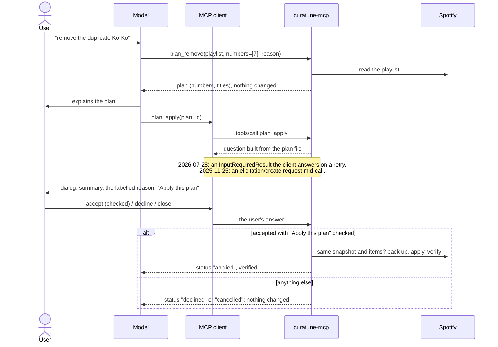
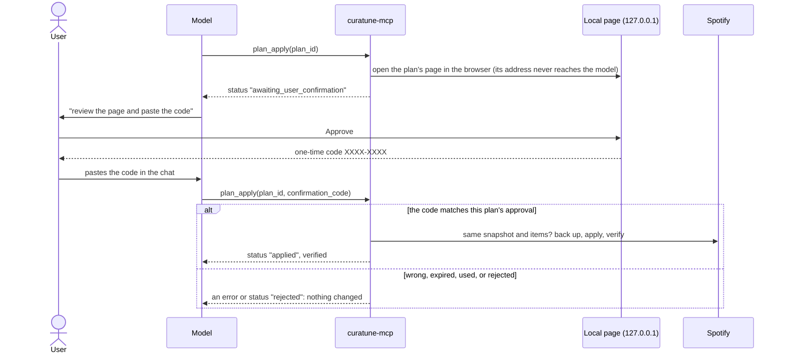

# curatune MCP server

`curatune-mcp` is a local [Model Context Protocol](https://modelcontextprotocol.io) server (stdio) over the
same library the CLI uses. MCP clients such as Claude Code, Claude Desktop, or LM Studio can work with your
playlists through it, with no repository-specific skill: the tool descriptions and the server's
instructions carry the rules. For the design and its decisions, see [design.md](design.md).

It reads playlists and the catalog, creates playlists, adds tracks, keeps recording dates, and removes,
reorders, or renames through **plans**: a plan changes nothing until the user confirms it outside the chat,
in a dialog the client shows or, for clients without one, on a local page that gives them a one-time code
(see [Confirming plans](#confirming-plans)). The model can answer neither.

## Install and connect

The server is an optional extra; the library and the CLI never need it.

```bash
cd api                                            # from the repository root
.venv/Scripts/python -m pip install -e ".[mcp]"   # .venv/bin/python on macOS/Linux
```

Set up as in the [README](../README.md#setup) first (`.env` with `SPOTIFY_CLIENT_ID`). To authorize, run
`curatune auth login` in a terminal, or ask the model to log in (`auth_login` opens the same consent page).
The server reads that same `.env`, token, and data directory (shared with the CLI), whatever directory the
client starts it in.

| Client | Configuration |
|---|---|
| Claude Code | `claude mcp add curatune -- <repo>/api/.venv/Scripts/curatune-mcp.exe` (`<repo>/api/.venv/bin/curatune-mcp` on macOS/Linux) |
| Claude Desktop | Settings → Developer → Edit Config, then add `"curatune": {"command": "<repo>/api/.venv/Scripts/curatune-mcp.exe"}` under `mcpServers`. If Claude Desktop is installed as an MSIX package and curatune has never run from a terminal, also add `"env": {"CURATUNE_DATA_DIR": "<a folder inside your user profile, such as one in Documents (not in AppData)>"}` (see `DATA_DIR_VIRTUALIZED` in [reference](reference.md#data-directory)). |
| LM Studio (0.3.17+) | Program tab → Install → Edit `mcp.json`, same `mcpServers` entry as Claude Desktop |
| Any, without the repository | `"command": "uvx", "args": ["--from", "curatune[mcp] @ git+https://github.com/gabriel-dg/curatune#subdirectory=api", "curatune-mcp"]`, or `"command": "curatune-mcp"` after `pipx install "curatune[mcp] @ git+https://github.com/gabriel-dg/curatune#subdirectory=api"` (see the [README](../README.md#without-cloning-the-repository): `.env` in the config directory) |

`<repo>` is the absolute path of your clone of the repository.

An MCP client starts the server with a reduced environment (variables set in your shell don't reach it):
put curatune's settings in its `.env`, or in the `env` of the server's entry.

A stdio server runs on the same machine as its client. To use LM Studio on another computer, install and
authorize curatune there too (its own `.env`, token, and data); a Development Mode app allows it, since it
is the same Spotify user.

Logs go to stderr. Clients differ in what they keep: Claude Desktop keeps one log file per server, while
Claude Code's per-server MCP log records connections and tool calls but not the server's stderr. On the
first call from each kind of client, the server records the protocol version, the client's name and
version, and the capabilities it declares (no personal data), both in its log and in `mcp_clients.json`
in the data directory. That file shows what each client really supports, whatever its log keeps.

## Demo mode

`curatune-mcp --demo` serves a synthetic account in memory instead of yours: a few playlists (one with
an exact duplicate, the same recording on another edition, and a shuffled order; another, "Late-night
picks", whose description tries to order the assistant around) and a small catalog. It
needs no Spotify account, no `.env`, and no token, and it makes no network call. Every tool works, plans
and their confirmation (dialog or page) included; plans and backups go to a temporary folder, and
everything disappears when the server stops. The server's instructions tell the model it is a demo.

```bash
claude mcp add curatune-demo -- <repo>/api/.venv/Scripts/curatune-mcp.exe --demo
```

(In Claude Desktop or LM Studio: the same `command`, with `"args": ["--demo"]`.) Track and album names
are real; every ID and ISRC is synthetic, so every `url` in the results is `null` (the output schemas allow
it, and say so): an open.spotify.com link to a synthetic ID would lead nowhere.

## Tools

RO = read-only; D = destructive; I = idempotent; OW = talks to Spotify. Every result is structured content
with a declared output schema, plus the same JSON as text.

| Tool | Does | RO | D | I | OW |
|---|---|---|---|---|---|
| `auth_status` | Whether curatune is authorized, and if not why (`CONFIG_ERROR`, `AUTH_REQUIRED`, `AUTH_EXPIRED`, `MISSING_SCOPES`, `LEGACY_DATA_NOT_MIGRATED`). Reads the token file only: no token, no user ID. | ✓ | | | |
| `auth_login` | Opens Spotify's consent page in the user's browser and returns at once (`authorized: false` plus a `next_step`); the authorization finishes in the background when they approve, and `auth_status` confirms it. When curatune is already authorized it opens nothing (`authorized: true`). Neither the token nor the consent URL reaches the result or a log. There is no logout tool: `curatune auth logout` in a terminal. | | | ✓ | ✓ |
| `playlists_list` | The user's playlists: id, name, owner, item count. `owned_only` filters. | ✓ | | | ✓ |
| `playlist_show` | A playlist and its tracks, numbered from 1, up to `limit` (≤100) per call from `start`; continue with `next_start`. `full` returns full track objects. | ✓ | | | ✓ |
| `search_tracks` | One catalog search (≤10 results, `offset` to page), free text and/or `track`, `artist`, `album`, `year` filters. | ✓ | | | ✓ |
| `search_many` | Up to 25 searches at once (4 concurrent), each with `limit` ≤10 (default 5); one failure doesn't fail the rest. | ✓ | | | ✓ |
| `track_show` | One track in full, with its ISRC. | ✓ | | | ✓ |
| `album_tracks` | An album's full listing (no ISRCs; `track_show` has them). | ✓ | | | ✓ |
| `recordings_show` | A playlist joined with the stored recording dates: `missing` and `chronological`. | ✓ | | | ✓ |
| `recordings_set` | Store recording dates. **Additive only**: tracks that already have a date are listed in `skipped` and left alone. Each date needs a checkable source (never the model's memory; `low` or ask when unchecked). Returns `stored`: what was stored, read back from the store, for the user to check. | | | ✓ | |
| `recordings_update` | Replace stored recording dates. Only when the user asks to correct one. Same source rules, and returns `stored` too. | | ✓ | ✓ | |
| `playlist_create` | Create an empty playlist. There is no visibility option: curatune always requests private, Spotify makes it public, and the result says so. | | | | ✓ |
| `playlist_add` | Add tracks (≤100 per call), appended or at `at_number`; already-present tracks are skipped unless `allow_duplicates`. To a playlist `playlist_create` made in this server process it runs at once; to any other, only **after the user confirms** the tracks, by name, in a dialog or on the confirmation page (below; the page's `confirmation_code` goes with the same arguments). Reads the playlist back: names each added track and reports `verified`. | | ✓ | | ✓ |
| `plan_remove` | Plan removing tracks by number. Every plan tool requires a `reason` (shown in the dialog, below). Builds a plan file; changes nothing on Spotify. | ✓¹ | | | ✓ |
| `plan_reorder` | Plan a new order: exactly one of `sort_by` (title, artist, album, released, duration, recorded; optional `descending`), `order` (every current number, in the new order), or `move_from` + `move_to`. | ✓¹ | | | ✓ |
| `plan_details` | Plan a rename and/or a new description. Never visibility. | ✓¹ | | | ✓ |
| `plan_show` | A plan by `plan_id`, and (with `check`) whether it still applies to the playlist as it is now. | ✓ | | | ✓ |
| `plan_apply` | Apply a plan **after the user confirms it** in a dialog or on the confirmation page (below). Takes `plan_id`, and on the page route the `confirmation_code` the user pastes. Checks, backs up, applies, verifies. | | ✓ | ✓ | ✓ |

¹ Plan builders change nothing on Spotify; their only effect is a local plan file that does nothing by
itself, so they are marked read-only (Claude Desktop runs read-only tools without a per-call prompt).
`plan_apply` is destructive, and also carries `_meta["anthropic/requiresUserInteraction"]`, so Claude Code
always asks before calling it, even in modes that skip prompts.

Why recording dates are two tools: `destructiveHint` describes the worst a tool can do with any
arguments. One tool with an `overwrite` flag would have to be marked destructive, so clients that prompt
for destructive tools (Claude Desktop always does) would prompt for every additive call too. Two tools give
each one accurate hints, and protect hand-curated dates in code rather than in a prompt.

## Resources and prompts

Besides the tools the model calls, the server offers things the **user** picks.

Resources (read-only JSON, the same views the tools return, numbered from 1, with a note that names and
descriptions are third-party text): attach them with an `@`-mention in Claude Code, or the "+" menu in
Claude Desktop.

| URI | What |
|---|---|
| `curatune://playlists` | Your playlists. |
| `curatune://playlists/{playlist_id}` | A playlist you own or collaborate on, with all its tracks. Each playlist you own is also listed on its own, by name. |
| `curatune://plans/{plan_id}` | A plan, as `plan_show` shows it (without the live check). Every `plan_*` result links to it. |

Listing resources reads your playlists once (in the background, and it never fails: without access, only
`curatune://playlists` is listed). Reading one changes nothing.

Prompts port the project skill's workflows; in Claude Code they are slash commands
(`/mcp__curatune__deduplicate`, …):

| Prompt | Arguments | Does |
|---|---|---|
| `deduplicate` | `playlist` | Finds exact duplicates (same URI), the same recording on another edition (same ISRC), and other versions of a tune (listed apart); proposes what to keep and why; removes through a plan you confirm. |
| `sort_chronologically` | `playlist` | Stores missing recording dates from checkable sources (low confidence or a question when it can't check), shows them, then reorders by recording date through a plan. |
| `complete_playlist` | `playlist`, `count`, `criterion` | Suggests tracks that fit, with the exact recordings, why, and how sure; adds them with one `playlist_add` after your OK. |

## Confirming plans

Before `plan_apply` changes anything, the person, not the model, has to say yes. Clients that show dialogs
(MCP form elicitation) ask there:



- **The question comes from the plan file**, not from the model: what leaves or moves, by number, title,
  and artists, or the old and new name and description. Third-party text in it is cleaned (no line breaks,
  no bidirectional-text tricks, length capped).
- **The model's reason is shown apart, and labelled.** Every plan tool requires a `reason` (at most 300
  characters): why, including the model's judgment calls, such as keeping one edition over another. The
  dialog shows it after the server's summary, set apart and labelled as the assistant's explanation, not
  checked by curatune, cleaned the same way. So the criterion is visible where the person decides, even
  when the model writes nothing in the chat, and it is never mistaken for what the server verified.
- **The model can't answer.** The answer reaches the server through the client's dialog. The resolvers that
  read it are not tool arguments: a model that passes `answer`, `apply`, or anything else gets them ignored.
- **A closed or unanswered dialog applies nothing.** A plan that is invalid, edited, already applied, more
  than 24 hours old (`PLAN_EXPIRED`: build a new one), or not a plan ID fails before anything is asked. The
  dialog and the page say when the plan was built.
- **Applying re-checks everything**, as `curatune plan apply` does: the playlist must still have the
  snapshot and items the plan was built on (`SNAPSHOT_MISMATCH` otherwise, nothing changed), it is backed
  up first, and the result is verified.

### The confirmation page

Clients without dialogs (and any client, with `CURATUNE_MCP_CONFIRM=browser`) confirm on a local page:



- **The page shows the plan file**, like the dialog: what leaves or moves, by number, title, and artists,
  with the model's `reason` apart and labelled. It is static HTML with no JavaScript; every piece of text is
  escaped, and a Content-Security-Policy allows only its own style and forms.
- **Only the person can get the code.** The page lives at an unguessable address (`/confirm/<32 random
  bytes>`) that curatune opens in the browser itself and never puts in a tool result, a log, or stderr.
  Approve and Reject are POSTs that need the page's exact `Host` (`127.0.0.1:<port>`, which stops DNS
  rebinding), a matching `Origin`, and the form's nonce, so another website can't press them.
- **A code is narrow.** 8 Crockford base32 characters (40 bits), compared ignoring case and hyphens. It
  is bound to the plan and its checksum, lasts 10 minutes from when the page opened, works once, and is
  used up before the plan is applied (a plan that fails its checks needs a new approval). Three wrong codes
  void the confirmation (`CONFIRMATION_VOID`); calling `plan_apply` with only the `plan_id` then opens a
  new page. Reject applies nothing, and until it expires `plan_apply` answers `rejected` without reopening.
- **No browser, no apply.** If no browser can be opened, `plan_apply` fails with
  `CONFIRMATION_UNAVAILABLE` and the CLI commands to review and apply the plan in a terminal. Confirmations
  live in memory: a server restart drops them, and the person approves again.

`CURATUNE_MCP_CONFIRM` (in `.env` or the environment; for one client, the `env` of its server entry) picks
the route:

| Value | Route |
|---|---|
| `auto` (default) | The dialog when the client declares form elicitation, otherwise the page. A change with more than 25 lines (removals, moves) always takes the page, which lists every line. |
| `elicitation` | The dialog only; without it, or for a change with more than 25 lines, `CONFIRMATION_UNAVAILABLE`. |
| `browser` | The page, even when the client declares dialogs (some declare them and drop the request). |

Clients verified so far (see [design.md](design.md#facts-the-design-rests-on-october-2026)): Claude Code
declares form and URL elicitation in both protocol eras, and both routes were checked live in it. Claude
Desktop is not verified yet. LM Studio documents tools only. If a client's `plan_apply` waits and no dialog
appears (a client that declares dialogs but doesn't show them), nothing is applied: set
`CURATUNE_MCP_CONFIRM=browser` in that server's entry to use the page.

### Confirming additions

Adding tracks changes a playlist too, and a model can be talked into it by text in a name or description.
So `playlist_add` runs at once only on a playlist `playlist_create` made in the same server process (the
usual "create a playlist with …" flow stays one step). Any other playlist, including one created before the
server restarted, needs the user's OK first, through the same routes as plans:

- curatune first reads the playlist and each track to add (one read per track, four at a time), so what it
  would refuse (not editable, `at_number` out of range, an unknown track) fails before anyone is asked, and
  a call where every track is already there writes nothing and asks nothing;
- the dialog lists the tracks by the number they will get, title, and artists, with the playlist's name
  (cleaned like a plan's text); only "accept" with "Add these tracks" checked adds them. More than 25
  tracks take the page, which lists all of them;
- on the page route the result is `awaiting_user_confirmation`; the page's one-time code is bound to the
  exact call (playlist, tracks in order, `at_number`, `allow_duplicates`), so the model calls `playlist_add`
  again with the same arguments plus `confirmation_code`. A code for one addition never approves another;
- no dialog and no browser, or `CURATUNE_MCP_CONFIRM=elicitation` without a dialog: nothing is added
  (`CONFIRMATION_UNAVAILABLE`), and the user can add the tracks in Spotify or with `curatune playlist add`.

The playlists a server created are remembered in memory only. `playlist_add` is annotated
`destructiveHint: true` with `requiresUserInteraction`, like `plan_apply`, so clients that use annotations
for their own prompts don't auto-approve it.

Outside what this protects: an agent with shell access acting on purpose (it could call Spotify directly
with the stored token, or read the page from the local machine), and a client set up to answer dialogs by
itself (for example a Claude Code `Elicitation` hook that auto-accepts).

## Conventions

- **Track numbers are 1-based.** Playlist items carry `number` (1 = first track, as in the Spotify app),
  and tools take numbers (`start`, `at_number`, plan `numbers`, `order`, `move_from`, `move_to`); plan views
  show where a moved track `was`. Warnings and error details that refer to items use
  `number`/`numbers` too. The CLI and [reference.md](reference.md) keep 0-based positions; the conversion
  happens in one module, `mcp_server/numbering.py`.
- **Compact by default.** Tracks come as `{number, uri, name, artists, album, released, duration, isrc,
  playable}`; `full: true` returns the full shapes of [reference.md](reference.md#shared-shapes), with
  `number` instead of `position`.
- **Errors** are tool results with `isError: true` and the text
  `{"error": {"code", "message", "details"}, "next_step": "…"}`. The codes are the CLI's
  ([reference.md](reference.md#error-codes)); `next_step`, when present, says what to do next (for example,
  ask the user to run `curatune auth login`).
- **Warnings** are the CLI's, inside each result's `warnings`.
- **Third-party text.** Names and descriptions of playlists, tracks, albums, and artists are written by
  other people. Tool descriptions and server instructions tell the model to treat them as data.

## Deliberate differences from the CLI

| CLI | MCP server | Why |
|---|---|---|
| 0-based `position` | 1-based `number` | Small models read 0-based positions as track numbers (curatune-web's evaluation), and every model talks to the user in 1-based numbers anyway. |
| `playlist create --public` | No visibility option | Visibility is never the model's choice; Spotify ignores it anyway. |
| `--from-file` inputs | JSON arguments only, never a path | A path argument could send a local file's contents to Spotify as search queries. |
| `recordings set` overwrites | `recordings_set` (additive) and `recordings_update` | Accurate annotations, and curated dates protected in code. |
| `playlist show` returns every item | Pages of up to 100 | Client limits on tool results (Claude Code: 25,000 tokens by default). |
| Batch search up to 50, 10 results each | `search_many` up to 25, 5 each by default | The same budget. |
| `meta` timing in every envelope | Not returned; logged to stderr | `metrics` is per process, and the server runs concurrent calls. |
| `--market` per command | `CURATUNE_MARKET` from `.env` | Fewer arguments to get wrong. |
| `plan apply` runs after an OK in the chat | `plan_apply` runs after an OK in the client's dialog, or a code from the confirmation page | The model can't answer the dialog or read the page. |
| `playlist add` executes | `playlist_add` executes on a playlist created in this server process; any other needs the same OK as a plan | The CLI's user runs each command; an MCP model calls tools on its own. |
| `plan show`/`plan apply` accept a plan file path | `plan_id` only | A path could point anywhere. |
| Error details may hold local paths (`backup_path`) | Paths are left out | They tell the model nothing it needs. |

Unknown top-level arguments are ignored (the SDK's behaviour); unknown keys inside `searches` or `entries`
are rejected.

## Development

```
src/curatune/mcp_server/
  __init__.py      main(): the curatune-mcp entry point; explains how to install the extra if missing
  server.py        runtime (settings, tokens, a client per call, write lock), result envelopes, next_step, probe
  tools.py         tool registrations: validate → numbers → library (in a worker thread) → view
  views.py         what the model sees: compact views of the library's results
  numbering.py     the only 0-based ↔ 1-based conversion
  confirm.py       the confirmation route, the question the user confirms, and the one-time codes (pure)
  approval_page.py the local confirmation page (127.0.0.1): render, Host/Origin/nonce checks, CSP (pure)
  resources.py     resources and prompts: what the user attaches or picks
  schemas.py       nested inputs and every tool's (strict) output model
  instructions.py  the server instructions
```

- `tests/test_mcp_server.py` drives the server through an in-memory MCP client in **both protocol eras**
  (the 2025-11-25 handshake and 2026-07-28) against `tests/fakes.py:FakeAccount`. It is skipped when the
  extra isn't installed.
- `tests/test_mcp_plans.py` builds, shows, and applies plans in both eras, with the client's elicitation
  callback playing the user: accept, accept unchecked, decline, close, no dialog at all, forged answers,
  edited plans, and a playlist that changed after approval.
- `tests/test_mcp_confirm.py` (pure) covers routes and the question's wording, cleaning, and cap;
  `tests/test_mcp_numbering.py` covers the conversion; `tests/test_mcp_invariants.py` checks that the
  server never imports `_writes` or `requests`, and that the library and the CLI never import `mcp`.
- CI (`.github/workflows/tests.yml`) runs the suite on pushes to `main` and on pull requests, on Windows
  and Linux, with Python 3.10 and 3.14, with and without the extra.
