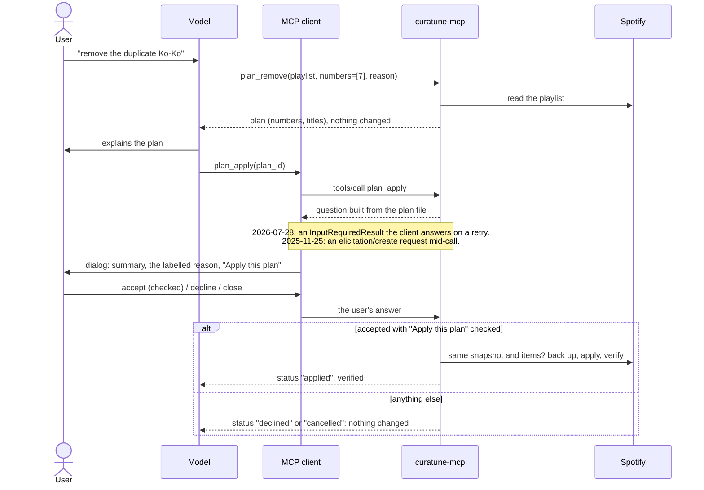

# curatune MCP server

`curatune-mcp` is a local [Model Context Protocol](https://modelcontextprotocol.io) server (stdio) over the
same library the CLI uses. MCP clients such as Claude Code, Claude Desktop, or LM Studio can work with your
playlists through it, with no repository-specific skill: the tool descriptions and the server's
instructions carry the rules. For the design and its decisions, see [PLAN-mcp.md](../PLAN-mcp.md).

It reads playlists and the catalog, creates playlists, adds tracks, keeps recording dates, and removes,
reorders, or renames through **plans**: a plan changes nothing until the user confirms it in a dialog the
client shows, which the model cannot answer (see [Confirming plans](#confirming-plans)). Clients that can't
show that dialog can build and review plans, but not apply them; the user applies those with the CLI.

## Install and connect

The server is an optional extra; the library and the CLI never need it.

```bash
.venv/Scripts/python -m pip install -e ".[mcp]"   # .venv/bin/python on macOS/Linux
```

Set up and authorize as in the [README](../README.md#setup) first (`.env` with `SPOTIFY_CLIENT_ID`, then
`curatune auth login`). Running from the repository's `.venv`, the server reads that same `.env` and token,
whatever directory the client starts it in.

| Client | Configuration |
|---|---|
| Claude Code | `claude mcp add curatune -- <repo>/.venv/Scripts/curatune-mcp.exe` (`<repo>/.venv/bin/curatune-mcp` on macOS/Linux) |
| Claude Desktop | Settings → Developer → Edit Config, then add `"curatune": {"command": "<repo>/.venv/Scripts/curatune-mcp.exe"}` under `mcpServers` |
| LM Studio (0.3.17+) | Program tab → Install → Edit `mcp.json`, same `mcpServers` entry as Claude Desktop |

A stdio server runs on the same machine as its client. To use LM Studio on another computer, install and
authorize curatune there too (its own `.env`, token, and data); a Development Mode app allows it, since it
is the same Spotify user.

Logs go to stderr. Clients differ in what they keep: Claude Desktop keeps one log file per server, while
Claude Code's per-server MCP log records connections and tool calls but not the server's stderr. On the
first call from each kind of client, the server records the protocol version, the client's name and
version, and the capabilities it declares (no personal data), both in its log and in `mcp_clients.json`
in the data directory. That file shows what each client really supports, whatever its log keeps.

## Tools

RO = read-only; D = destructive; I = idempotent; OW = talks to Spotify. Every result is structured content
with a declared output schema, plus the same JSON as text.

| Tool | Does | RO | D | I | OW |
|---|---|---|---|---|---|
| `auth_status` | Whether curatune is authorized, and if not why (`CONFIG_ERROR`, `AUTH_REQUIRED`, `AUTH_EXPIRED`, `MISSING_SCOPES`). Reads the token file only: no token, no user ID. | ✓ | | | |
| `playlists_list` | The user's playlists: id, name, owner, item count. `owned_only` filters. | ✓ | | | ✓ |
| `playlist_show` | A playlist and its tracks, numbered from 1, up to `limit` (≤100) per call from `start`; continue with `next_start`. `full` returns full track objects. | ✓ | | | ✓ |
| `search_tracks` | One catalog search (≤10 results, `offset` to page), free text and/or `track`, `artist`, `album`, `year` filters. | ✓ | | | ✓ |
| `search_many` | Up to 25 searches at once (4 concurrent), each with `limit` ≤10 (default 5); one failure doesn't fail the rest. | ✓ | | | ✓ |
| `track_show` | One track in full, with its ISRC. | ✓ | | | ✓ |
| `album_tracks` | An album's full listing (no ISRCs; `track_show` has them). | ✓ | | | ✓ |
| `recordings_show` | A playlist joined with the stored recording dates: `missing` and `chronological`. | ✓ | | | ✓ |
| `recordings_set` | Store recording dates. **Additive only**: tracks that already have a date are listed in `skipped` and left alone. | | | ✓ | |
| `recordings_update` | Replace stored recording dates. Only when the user asks to correct one. | | ✓ | ✓ | |
| `playlist_create` | Create an empty playlist. There is no visibility option: curatune always requests private, Spotify makes it public, and the result says so. | | | | ✓ |
| `playlist_add` | Add tracks (≤100 per call), appended or at `at_number`; already-present tracks are skipped unless `allow_duplicates`. Reads the playlist back: names each added track and reports `verified`. | | | | ✓ |

| `plan_remove` | Plan removing tracks by number. Every plan tool requires a `reason` (shown in the dialog, below). Builds a plan file; changes nothing on Spotify. | ✓¹ | | | ✓ |
| `plan_reorder` | Plan a new order: exactly one of `sort_by` (title, artist, album, released, duration, recorded; optional `descending`), `order` (every current number, in the new order), or `move_from` + `move_to`. | ✓¹ | | | ✓ |
| `plan_details` | Plan a rename and/or a new description. Never visibility. | ✓¹ | | | ✓ |
| `plan_show` | A plan by `plan_id`, and (with `check`) whether it still applies to the playlist as it is now. | ✓ | | | ✓ |
| `plan_apply` | Apply a plan **after the user confirms it in a dialog** (below). Takes only `plan_id`. Checks, backs up, applies, verifies. | | ✓ | ✓ | ✓ |

¹ Plan builders change nothing on Spotify; their only effect is a local plan file that does nothing by
itself, so they are marked read-only (Claude Desktop runs read-only tools without a per-call prompt).
`plan_apply` is destructive, and also carries `_meta["anthropic/requiresUserInteraction"]`, so Claude Code
always asks before calling it, even in modes that skip prompts.

Why recording dates are two tools: `destructiveHint` describes the worst a tool can do with any
arguments. One tool with an `overwrite` flag would have to be marked destructive, so clients that prompt
for destructive tools (Claude Desktop always does) would prompt for every additive call too. Two tools give
each one accurate hints, and protect hand-curated dates in code rather than in a prompt.

## Confirming plans

`plan_apply` takes only a `plan_id`. Before it changes anything, the person, not the model, has to say yes:



- **The question comes from the plan file**, not from the model: what leaves or moves, by number, title,
  and artists, or the old and new name and description. Third-party text in it is cleaned (no line breaks,
  no bidirectional-text tricks, length capped).
- **The model's reason is shown apart, and labelled.** Every plan tool requires a `reason` (at most 300
  characters): why, including the model's judgment calls, such as keeping one edition over another. The
  dialog shows it after the server's summary, set apart and labelled as the assistant's explanation, not
  checked by curatune, cleaned the same way. So the criterion is visible where the person decides, even
  when the model writes nothing in the chat, and it is never mistaken for what the server verified.
- **The model can't answer.** The answer reaches the server through the client's dialog. The resolvers that
  read it are not tool arguments: a model that passes `answer`, `apply`, or anything else gets them ignored.
- **No dialog, no apply.** A client that doesn't declare form elicitation gets `CONFIRMATION_UNAVAILABLE`,
  with the CLI commands to review and apply the plan in a terminal. A plan that is invalid, edited, already
  applied, or not a plan ID fails before anything is asked. A closed or unanswered dialog applies nothing.
- **Applying re-checks everything**, as `curatune plan apply` does: the playlist must still have the
  snapshot and items the plan was built on (`SNAPSHOT_MISMATCH` otherwise, nothing changed), it is backed
  up first, and the result is verified.
- `CURATUNE_MCP_CONFIRM` (in `.env` or the environment) picks the route: `auto` (default) and
  `elicitation` use the dialog. `browser`, a local confirmation page with a one-time code for clients
  without dialogs, comes in a later version; until then it fails closed.

Clients verified so far (see PLAN-mcp.md): Claude Code declares form and URL elicitation in both protocol
eras. Claude Desktop is not verified yet. LM Studio documents tools only.

Outside what this protects: an agent with shell access acting on purpose (it could call Spotify directly
with the stored token), and a client set up to answer dialogs by itself (for example a Claude Code
`Elicitation` hook that auto-accepts).

## Conventions

- **Track numbers are 1-based.** Playlist items carry `number` (1 = first track, as in the Spotify app),
  and tools take numbers (`start`, `at_number`, plan `numbers`, `order`, `move_from`, `move_to`); plan views
  show where a moved track `was`. Warnings and error details that refer to items use
  `number`/`numbers` too. The CLI and [reference.md](reference.md) keep 0-based positions; the conversion
  happens in one module, `mcp_server/numbering.py`.
- **Compact by default.** Tracks come as `{number, uri, name, artists, album, released, duration, isrc,
  playable}`; `full: true` returns the full shapes of [reference.md](reference.md#shared-shapes), with
  `number` instead of `position`.
- **Errors** are tool results with `isError: true` and the text
  `{"error": {"code", "message", "details"}, "next_step": "…"}`. The codes are the CLI's
  ([reference.md](reference.md#error-codes)); `next_step`, when present, says what to do next (for example,
  ask the user to run `curatune auth login`).
- **Warnings** are the CLI's, inside each result's `warnings`.
- **Third-party text.** Names and descriptions of playlists, tracks, albums, and artists are written by
  other people. Tool descriptions and server instructions tell the model to treat them as data.

## Deliberate differences from the CLI

| CLI | MCP server | Why |
|---|---|---|
| 0-based `position` | 1-based `number` | Small models read 0-based positions as track numbers (spotikit-web's evaluation), and every model talks to the user in 1-based numbers anyway. |
| `playlist create --public` | No visibility option | Visibility is never the model's choice; Spotify ignores it anyway. |
| `--from-file` inputs | JSON arguments only, never a path | A path argument could send a local file's contents to Spotify as search queries. |
| `recordings set` overwrites | `recordings_set` (additive) and `recordings_update` | Accurate annotations, and curated dates protected in code. |
| `playlist show` returns every item | Pages of up to 100 | Client limits on tool results (Claude Code: 25,000 tokens by default). |
| Batch search up to 50, 10 results each | `search_many` up to 25, 5 each by default | The same budget. |
| `meta` timing in every envelope | Not returned; logged to stderr | `metrics` is per process, and the server runs concurrent calls. |
| `--market` per command | `CURATUNE_MARKET` from `.env` | Fewer arguments to get wrong. |
| `plan apply` runs after an OK in the chat | `plan_apply` runs after an OK in the client's dialog | The dialog can't be answered by the model. |
| `plan show`/`plan apply` accept a plan file path | `plan_id` only | A path could point anywhere. |
| Error details may hold local paths (`backup_path`) | Paths are left out | They tell the model nothing it needs. |

Unknown top-level arguments are ignored (the SDK's behaviour); unknown keys inside `searches` or `entries`
are rejected.

## Development

```
src/curatune/mcp_server/
  __init__.py      main(): the curatune-mcp entry point; explains how to install the extra if missing
  server.py        runtime (settings, tokens, a client per call, write lock), result envelopes, next_step, probe
  tools.py         tool registrations: validate → numbers → library (in a worker thread) → view
  views.py         what the model sees: compact views of the library's results
  numbering.py     the only 0-based ↔ 1-based conversion
  confirm.py       the confirmation route and the question the user confirms (pure)
  schemas.py       nested inputs and every tool's (strict) output model
  instructions.py  the server instructions
```

- `tests/test_mcp_server.py` drives the server through an in-memory MCP client in **both protocol eras**
  (the 2025-11-25 handshake and 2026-07-28) against `tests/fakes.py:FakeAccount`. It is skipped when the
  extra isn't installed.
- `tests/test_mcp_plans.py` builds, shows, and applies plans in both eras, with the client's elicitation
  callback playing the user: accept, accept unchecked, decline, close, no dialog at all, forged answers,
  edited plans, and a playlist that changed after approval.
- `tests/test_mcp_confirm.py` (pure) covers routes and the question's wording, cleaning, and cap;
  `tests/test_mcp_numbering.py` covers the conversion; `tests/test_mcp_invariants.py` checks that the
  server never imports `_writes` or `requests`, and that the library and the CLI never import `mcp`.
- CI (`.github/workflows/tests.yml`) runs the suite on Windows and Linux, Python 3.10 and 3.14, with and
  without the extra.
